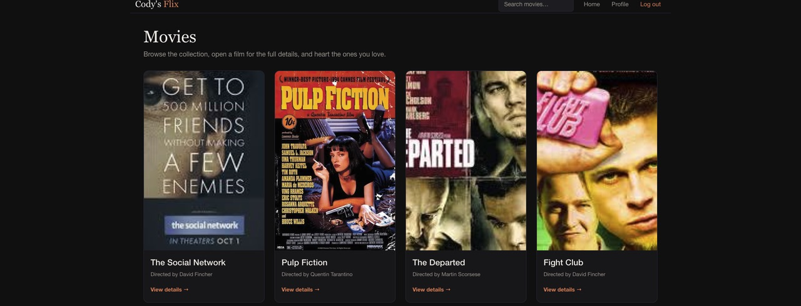

# Cody's Flix: React Client

A single-page React app for browsing movies, reading about directors and genres,
and saving favorites. It runs on top of my
[Cody's Flix REST API](https://github.com/Cody-Ayers/movie_api)
(Node.js, Express, MongoDB).

**Live demo:** https://codys-flix.netlify.app



## Features

- Sign up and log in; the token and user are kept in `localStorage` so you stay signed in
- Movie grid with posters, directors and genres
- Live search by title from the navigation bar
- Movie detail page with the synopsis, genre and director
- Favorites: add or remove movies from any card
- Profile page: see your favorites, update your details, or delete your account
- Responsive layout with React Bootstrap

## Tech stack

| Area | Tools |
|---|---|
| Framework | React 18 |
| Routing | React Router 6 |
| UI | React Bootstrap, Bootstrap 5, SCSS |
| Build | Parcel |
| Deployment | Netlify |
| API | [Cody's Flix API](https://github.com/Cody-Ayers/movie_api) with JWT auth |

## Project structure

```text
src/
├── index.jsx                 # App entry point
├── index.scss
└── components/
    ├── main-view/            # Routes, data loading and search
    ├── navigation-bar/
    ├── login-view/
    ├── signup-view/
    ├── movie-card/
    ├── movie-view/           # Movie detail page
    └── profile-view/         # Profile and favorites
```

## Running locally

```bash
git clone https://github.com/Cody-Ayers/codysFlix-client.git
cd codysFlix-client
npm install
npx parcel src/index.html
```

Open http://localhost:1234 and sign up for an account to start browsing.
